# 👻 또마니또 (Ttomanito)

<div align="center">
  
</div>

> **익명 마니또 게임을 모바일 웹에서.** 1:1 채팅 · 오늘의 미션 · 콕 찌르기 · 마니또 추측 · 음성변조 통화 · 관찰 리포트까지 한 사이클로 이어지는 소셜 웹앱입니다.

**한 줄 요약** — 4명 이상이 모이면 서버가 참가자를 섞어 순환 배정으로 마니또/마니띠를 정하고, 각 쌍은 전용 채팅방에서 미션과 추측을 주고받습니다. 게임이 끝나면 그동안의 상호작용을 집계해 **관찰 리포트**로 돌려줍니다.

| 항목 | 내용 |
| --- | --- |
| 서비스 형태 | 모바일 웹 (PWA 설치 지원) |
| 기간 | 2025.07.14 ~ 2025.08.15 (5주) |
| 소속 | SSAFY 13기 공통 프로젝트 (6인 팀 — 프론트엔드 3 · 백엔드 2 · 인프라 1) |
| 저장소 구성 | `backend/` Spring Boot · `frontend/` React · `nginx/` 리버스 프록시 · `exec/` ERD·화면 캡처·DDL · 루트 `docker-compose.yml` |
| 저장소 | MySQL(도메인 메타) · MongoDB(채팅 메시지·AI 분석) · Redis(토큰) |
| 실시간 | STOMP over WebSocket(SockJS) · OpenVidu 2.22(WebRTC 음성) |
| 문서 기준 | `master` @ `f09bea4` (코드·설정 파일에서 확인한 내용만 기술) |

> 상시 운영 중인 데모 서버는 없습니다. 전체 스택은 아래 [로컬 실행](#13-로컬-실행) 절차로 Docker Compose에 그대로 올릴 수 있습니다.

---

## 목차

1. [서비스 소개](#1-서비스-소개)
2. [주요 기능](#2-주요-기능)
3. [게임 진행 흐름](#3-게임-진행-흐름)
4. [시스템 아키텍처](#4-시스템-아키텍처)
5. [기술 스택](#5-기술-스택)
6. [데이터 설계 (3-DB 분리)](#6-데이터-설계-3-db-분리)
7. [실시간 통신 설계 (WebSocket / STOMP)](#7-실시간-통신-설계-websocket--stomp)
8. [음성변조 통화](#8-음성변조-통화)
9. [AI 성향 분석](#9-ai-성향-분석)
10. [푸시 알림과 PWA](#10-푸시-알림과-pwa)
11. [인증과 인가](#11-인증과-인가)
12. [트러블슈팅](#12-트러블슈팅)
13. [로컬 실행](#13-로컬-실행)
14. [API 요약](#14-api-요약)
15. [디렉터리 구조](#15-디렉터리-구조)
16. [추후 개선 방향](#16-추후-개선-방향)

---

## 1. 서비스 소개

**문제** — 오프라인 마니또 게임은 누가 마니또인지, 누구에게 무엇을 해줬는지 기록이 남지 않습니다. 진행자가 종이에 적어 돌리는 방식이라 게임이 끝나면 관계의 흔적도 함께 사라집니다.

**접근** — 게임의 모든 상호작용(채팅·미션·찌르기·추측·통화)을 서버가 남기고, 그 기록을 게임 종료 시점에 정리해 돌려줍니다. 익명성을 유지해야 게임이 성립하므로 1:1 채팅은 마니또/마니띠 쌍에게만 열리고, 상대의 이름은 종료 전까지 드러나지 않습니다.

**결과** — 참가자는 게임 중에는 미션과 추측으로 상대를 알아가고, 종료 후에는 "내가 받은 도움"과 "내가 준 도움"을 수치와 목록으로 확인합니다. 상대가 나를 몇 번 맞혔는지, 몇 번 찔렀는지까지 남습니다.

---

## 2. 주요 기능

| 기능 | 동작 | 주요 구현 |
| --- | --- | --- |
| 방 생성 · 대기방 | 방 이름, 종료일(오늘 ~ 30일), 미션 수행 요일(월~일)을 고르고 생성. 초대 링크 복사, 상태 메시지, 참가자 강퇴, 방장의 대기방 삭제 | `frontend/src/pages/Room/*`, `RoomService`, `WaitingSocketController` |
| 마니또 배정 | 참가자 목록을 섞은 뒤 `i → i+1` 순환 배정. 배정마다 1:1 채팅방과 채팅 참여자 2명을 함께 생성 (최소 4명) | `RoomService.startGame` |
| 오늘의 미션 | 방에서 고른 요일에만 발급. 방·마니또·날짜당 1건, 과거에 받은 미션은 제외하고 랜덤 선택. 완료 처리 후 이력 조회 | `MissionService`, `DailyMission`, `MissionStatus` |
| 1:1 채팅 | STOMP 개인 큐로 상대에게만 전달, MongoDB에 append 저장, 50건 단위 역순 페이징 | `ChatWebSocketController`, `ChattingService` |
| 콕 찌르기 | 찌르기 로그 저장 + 채팅 이벤트(랜덤 문구) + 마니또에게 알림·푸시 | `PokeService`, `ChattingService.sendPoke`, `NoticeService` |
| 마니또 추측 | 팀원 중 1명을 선택해 제출, 정답 여부 저장, 추측 이력 조회, 마니또에게 알림 | `ManitoService`, `ManitoGuess` |
| 음성 통화 | OpenVidu 세션/토큰 발급 후 오디오 전용 1:1 통화, Tone.js 피치 변조, 통화 시간 기록 | `SessionController`, `useOpenVidu1to1`, `VoiceChat` — [8절](#8-음성변조-통화) 참고 |
| AI 성향 분석 | 상대와의 채팅 로그로 말투·행동 팁 3개·주의점을 요약. 요청자당 1회 분석 후 캐시 | `ChatAnalysisService` |
| 중간 랭킹 | 통화 시간 · 채팅 수 · 미션 수행 수 3개 지표로 방 내 순위 | `RankingService` |
| 관찰 리포트 | 종료된 방에서 받은 도움/준 도움, 찌르기·채팅·통화·추측 횟수와 미션 목록 | `ReportService` |
| 알림 | 알림함(미션·추측·찌르기·게임 종료), FCM 웹 푸시 | `NoticeService`, `FcmService` |
| PWA | 홈 화면 설치, 서비스 워커 등록, 백그라운드 푸시 수신 | `vite.config.ts`, `public/firebase-messaging-sw.js` |

### 주요 화면

| 로그인 | 오늘의 미션 | 마니또 추측 |
| --- | --- | --- |
| 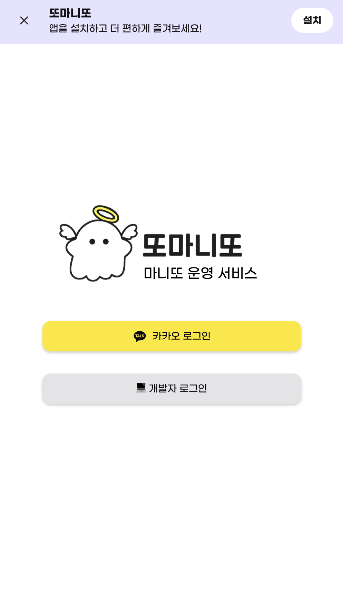 | 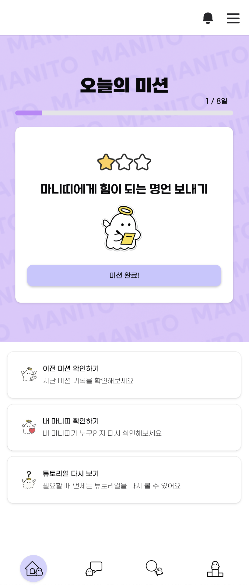 | 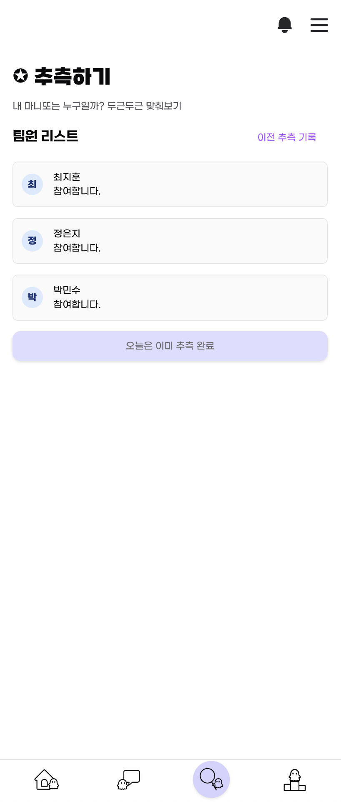 |

| 1:1 채팅 | 중간 랭킹 | 관찰 리포트 |
| --- | --- | --- |
| 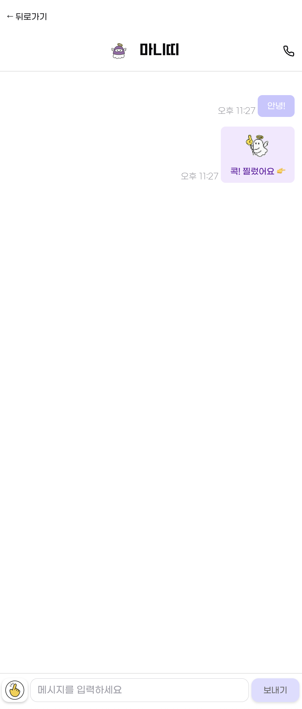 | 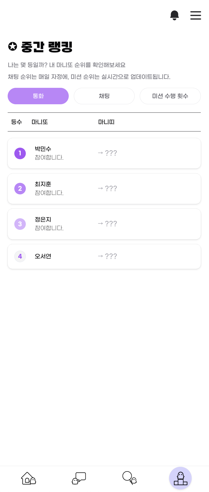 | 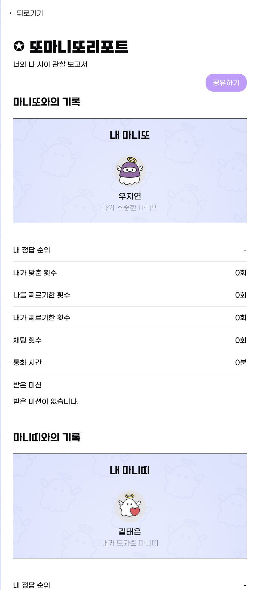 |

> 화면 캡처 원본은 `exec/Demo/ttomanito-capture/`에 있고, 화면 흐름은 `exec/Demo/화면시나리오.pdf`에 정리되어 있습니다.

---

## 3. 게임 진행 흐름

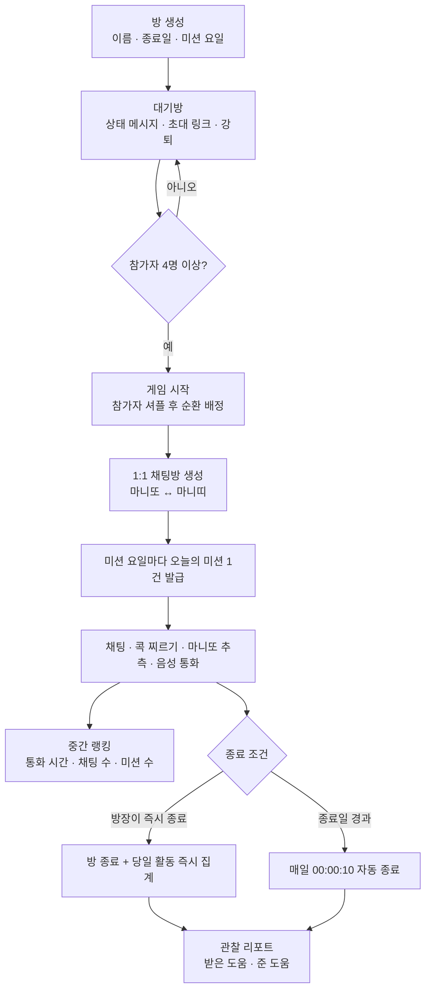

- **배정 규칙**: `RoomService.startGame`에서 참가자를 섞고 `i`번째가 `(i+1)`번째의 마니또가 되는 방식입니다. 인원수와 무관하게 모든 참가자가 정확히 한 번 마니또, 한 번 마니띠가 됩니다.
- **종료 조건 두 가지**: 방장의 즉시 종료(`POST /manito/finish`)와 종료일 경과 시 스케줄러(`RoomScheduler`, 매일 00:00:10 KST) 종료입니다.
- **미션 발급 요일**: 방 생성 시 고른 요일(`mission_day`)에만 발급되고, 그 외 요일에는 "오늘은 미션 발급 요일이 아닙니다" 응답을 반환합니다.

---

## 4. 시스템 아키텍처

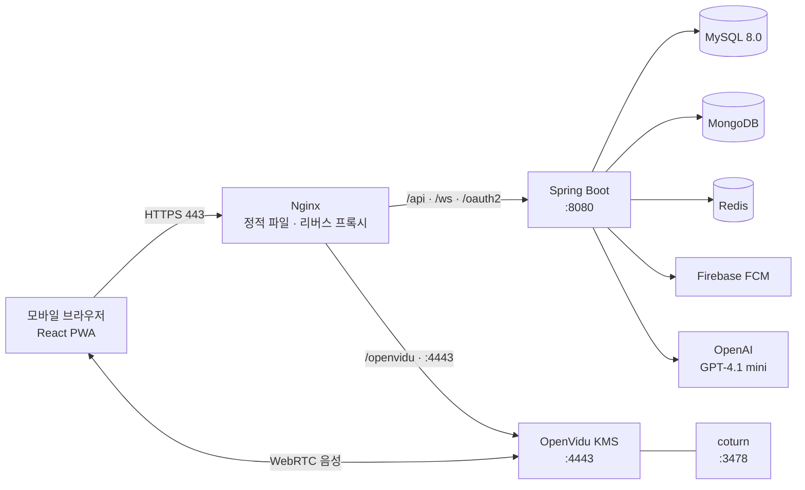

### 컨테이너 구성 (`docker-compose.yml`)

| 서비스 | 이미지 | 포트 | 역할 |
| --- | --- | --- | --- |
| `nginx` | `frontend/Dockerfile` 빌드 (nginx:alpine) | 80, 443, 4443 | React 빌드 결과물 서빙 + 백엔드·OpenVidu 프록시, 80 → 443 리다이렉트 |
| `backend` | `backend/Dockerfile` 빌드 (eclipse-temurin:17-jdk) | expose 8080 | Spring Boot API·WebSocket 서버 (외부 노출 없이 Nginx 경유) |
| `mysql` | `mysql:8.0` | 3306 | 도메인 메타 데이터 |
| `mongo` | `mongo:latest` | 27017 | 채팅 메시지·AI 분석 문서 |
| `redis` | `redis:latest` (appendonly) | 6379 | 리프레시 토큰, 폐기된 액세스 토큰 |
| `mongo-express` | `mongo-express:latest` | 8081 | MongoDB 관리 도구 |
| `openvidu-server-kms` | `openvidu/openvidu-server-kms:2.22.0` | 41000-41100/udp | WebRTC 미디어 서버 (KMS) |
| `coturn` | `instrumentisto/coturn` | 3478 tcp/udp | TURN 릴레이 |

### Nginx 라우팅 (`nginx/default.conf`)

| 경로 | 대상 | 비고 |
| --- | --- | --- |
| `/` | `/usr/share/nginx/html` | SPA fallback(`try_files $uri /index.html`), 캐시 비활성 |
| `/api/` | `backend-app:8080` | `rewrite ^/api/(.*)$ /$1` |
| `/ws/` | `backend-app:8080/ws/` | WebSocket Upgrade 헤더 유지 |
| `/openvidu/`, `/dashboard/`, `/inspector/` | `openvidu-server-kms:4443` | 자체 서명 인증서 허용(`proxy_ssl_verify off`) |
| `/login/`, `/auth/`, `/oauth2/`, `/v3/api-docs`, `/swagger-ui/` | `backend-app:8080` | 카카오 로그인 콜백·API 문서 |

---

## 5. 기술 스택

### 백엔드

| 구분 | 기술 | 버전 | 근거 파일 |
| --- | --- | --- | --- |
| 언어/런타임 | Java (Temurin) | 17 | `backend/Dockerfile` |
| 프레임워크 | Spring Boot | 3.5.3 | `backend/build.gradle` |
| 빌드 | Gradle (wrapper 8.13, 이미지 빌드는 8.4.0) | 8.13 / 8.4.0 | `gradle-wrapper.properties`, `Dockerfile` |
| ORM | Spring Data JPA (Hibernate, `ddl-auto=none`) | Boot 관리 버전 | `application.properties` |
| DB | MySQL | 8.0 (`mysql-connector-java` 8.0.33) | `build.gradle`, `docker-compose.yml` |
| 문서 DB | Spring Data MongoDB | Boot 관리 버전 | `build.gradle` |
| 캐시/토큰 | Spring Data Redis (Lettuce) | Boot 관리 버전 | `RedisConfig` |
| 인증 | Spring Security + OAuth2 Client(카카오 OIDC) + JJWT | jjwt 0.11.5 | `build.gradle` |
| 실시간 | Spring WebSocket(STOMP), Spring Security Messaging | Boot 관리 버전 | `WebSocketConfig` |
| WebRTC | OpenVidu Java Client | 2.22.0 | `build.gradle` |
| 푸시 | Firebase Admin SDK | 9.5.0 | `build.gradle` |
| AI | openai-java | 3.0.3 (모델 `gpt-4.1-mini`) | `build.gradle`, `ChatAnalysisService` |
| API 문서 | springdoc-openapi (Swagger UI) | 2.8.9 | `build.gradle`, `SwaggerConfig` |

### 프론트엔드

| 구분 | 기술 | 버전 | 근거 파일 |
| --- | --- | --- | --- |
| 언어 | TypeScript | ^5.8.3 | `package.json` |
| 프레임워크 | React | ^19.1.0 | `package.json` |
| 빌드 | Vite | ^7.0.4 | `package.json` |
| UI | Chakra UI (+ Emotion, framer-motion) | ^3.22.0 | `package.json` |
| 상태 | Zustand (persist) | ^5.0.7 | `stores/authStore.ts` |
| 라우팅 | React Router | ^7.7.0 | `routes/routes.tsx` |
| HTTP | axios | ^1.11.0 | `api/client.ts` |
| 실시간 | @stomp/stompjs + sockjs-client | ^7.1.1 / ^1.6.1 | `utils/useChatSocket.ts` |
| WebRTC | openvidu-browser + Tone.js | 2.22.0 / ^15.1.22 | `hooks/useOpenVidu1to1.ts` |
| 푸시/PWA | firebase, vite-plugin-pwa | ^12.1.0 / ^1.0.1 | `firebase/*`, `vite.config.ts` |
| 목록 | react-virtuoso, react-infinite-scroll-component | ^4.14.0 / ^6.1.0 | `package.json` |
| 품질 | Storybook, Vitest(browser), Playwright, ESLint, Prettier | 9.x / 3.x / 1.x | `package.json`, `vite.config.ts` |

---

## 6. 데이터 설계 (3-DB 분리)

"채팅"이라는 한 단어로 묶이지만 **도메인 메타(강한 일관성)** · **메시지(append-only)** · **토큰(TTL)** 은 갱신 빈도와 요구사항이 다릅니다. 단일 RDB로 모두 처리하지 않고 역할별로 저장소를 나눴습니다.

| 저장소 | 담당 | 컬렉션/테이블 | 선택 이유 |
| --- | --- | --- | --- |
| MySQL | 게임 도메인 메타 | `user`, `room`, `room_user`, `mission_day`, `manito_assignment`, `chatting_room`, `chatting_user`, `voice_chat`, `poke_log`, `manito_guess`, `mission`, `daily_mission`, `mission_status`, `manito_activity`, `notification`, `push_token`, `oauth_identity` (17개) | 외래 키와 트랜잭션이 필요한 배정·미션·집계 |
| MongoDB | 채팅 메시지, AI 분석 결과 | `chat_message`, `chat_analysis` | 외래 키 없이 빠르게 append, `sentAt` 역순 페이지네이션 |
| Redis | 리프레시 토큰, 폐기된 액세스 토큰 | `refreshToken`(RedisHash), `at:revoked:{token}` | TTL 기반 만료 처리 |

### ERD


원본: `exec/Erd/또마니또erd.png` · DDL: `exec/DataBase/ttomanito_ddl.sql` (= `backend/src/main/resources/ttomanito_ddl_0811.sql`)

### 핵심 관계

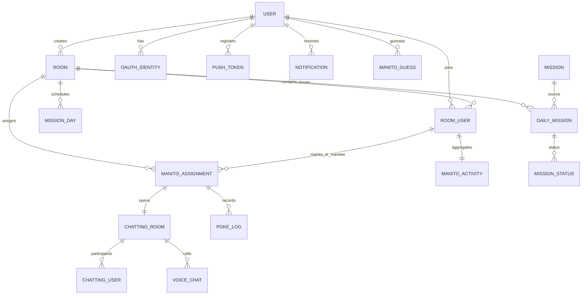

### 설계 포인트

- **`manito_assignment`가 게임의 중심축**입니다. 마니또(`manito_id`)·마니띠(`manitee_id`)·방(`room_id`)을 묶고, 채팅방·찌르기 로그·리포트 집계가 모두 이 배정을 기준으로 이어집니다.
- **`manito_activity`는 `room_user_id`를 PK이자 FK로 공유**(`@MapsId`)합니다. 참가자별 집계값을 별도 키 없이 1:1로 붙이고, 동시 갱신은 `@Version`으로 제어합니다.
- **`chatting_user`·`voice_chat`은 복합키**(`@IdClass`)입니다. 채팅방-참가자, 채팅방-참가자 단위로 1건만 존재하도록 모델링했습니다.
- **`mission.channel`은 `MEET`/`CHAT`/`CALL`을 `/`로 연결한 문자열**이고, 엔티티에서 `getChannelList()`로 분해해 내려줍니다.
- 미션 마스터 데이터는 `exec/DataBase/mission_data.sql`에 95건이 시드로 들어 있습니다(선물·소통·수행·기록·관찰 5개 타입).

---

## 7. 실시간 통신 설계 (WebSocket / STOMP)

SockJS 기반 STOMP 엔드포인트 3개를 열고, 채팅은 **개인 큐**(`/user/queue/chat.{chatRoomId}`), 대기방은 **방 토픽**(`/topic/waiting/{roomId}`)으로 나눴습니다.

| 구분 | 목적지 | 방향 | 용도 |
| --- | --- | --- | --- |
| Endpoint | `/ws/chat`, `/ws/waiting`, `/ws` | handshake | JWT 인터셉터 부착, 로컬 오리진 허용 |
| Publish | `/app/chat.send.{chatRoomId}` | → 서버 | 텍스트 메시지 전송 |
| Publish | `/app/chat.history.{chatRoomId}` | → 서버 | 이전 메시지 50건 요청 |
| Publish | `/app/chat.poke.{chatRoomId}` | → 서버 | 콕 찌르기 이벤트 |
| Publish | `/app/chat.call.start\|accept\|reject.{chatRoomId}` | → 서버 | 통화 요청/수락/거절 이벤트 |
| Publish | `/app/waiting/enter`, `/app/waiting/exit` | → 서버 | 대기방 입·퇴장 브로드캐스트 |
| Subscribe | `/user/queue/chat.{chatRoomId}` | ← 서버 | `{type: "HISTORY" \| "MESSAGE", data}` |
| Subscribe | `/topic/chat.{chatRoomId}` | ← 서버 | 방 브로드캐스트(에코 포함) |
| Subscribe | `/topic/waiting/{roomId}` | ← 서버 | 참가자 입·퇴장, 강퇴, 시작, 방 닫힘 |

### WebSocket 인증 — 2단계 인터셉터로 Principal 통일

HTTP 요청의 인증 컨텍스트(`SecurityContext`)는 비동기 WebSocket 채널로 그대로 전달되지 않습니다. 그래서 핸드셰이크 단계에서 토큰을 세션 속성에 넣고, STOMP `CONNECT` 단계에서 그 토큰으로 Principal을 다시 세우는 2단계 구조를 썼습니다.

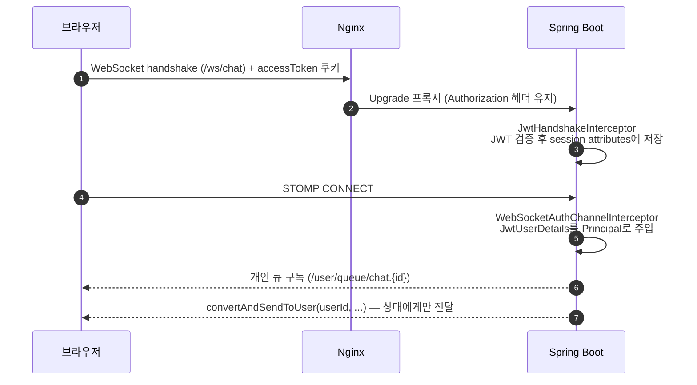

`JwtUserDetails`는 `UserDetails`와 `Principal`을 동시에 구현하고 `getName()`이 `userId`를 반환합니다. 덕분에 HTTP 컨트롤러와 WebSocket 컨트롤러가 **같은 사용자 식별자**로 동작합니다.

```java
// backend/.../global/security/userdetails/JwtUserDetails.java
public class JwtUserDetails implements UserDetails, Principal {
    private final Long userId;
    ...
    @Override public String getName() { return userId.toString(); }
}
```

### 메시지 타입

| 타입 | 저장소 | 용도 | 부가 처리 |
| --- | --- | --- | --- |
| `TEXT` | MongoDB `chat_message` | 일반 텍스트 | `chatting_room.last_message` 갱신, 미읽음 수 증가, FCM 푸시 |
| `POKE` | MongoDB | 콕 찌르기(랜덤 문구) | 푸시 "콕 찌르기" |
| `CALL_START` | MongoDB | 통화 요청 | 푸시 "통화 요청" |
| `CALL_ACCEPT` | MongoDB | 통화 수락 | 푸시 "통화 수락" |
| `CALL_REJECT` | MongoDB | 통화 거절 | 푸시 "통화 거절" |

---

## 8. 음성변조 통화

익명이 유지되는 1:1 통화에서 목소리까지 바뀌면 상대를 추측하는 재미가 커집니다. **OpenVidu(WebRTC)로 오디오 1:1 통화를 열고, 송신 트랙에 Tone.js `PitchShift`를 걸어 목소리를 변조**하는 구조로 만들었습니다. 프로젝트 중간 시연에서는 변조된 음성이 상대에게 전달되는 것까지 확인했고, 이후 여러 브랜치를 병합하며 리팩토링하는 과정에서 진입 경로와 세션 연결부가 하나의 흐름으로 재통합되지 않은 채 `master`에 남아 있습니다.

### 8.1 구현

| 계층 | 내용 | 근거 |
| --- | --- | --- |
| 인프라 | OpenVidu KMS 2.22.0 컨테이너, coturn TURN 서버, Nginx의 `/openvidu/`·`:4443` 프록시, Let's Encrypt 인증서 | `docker-compose.yml`, `nginx/default.conf` |
| 백엔드 | `POST /openvidu/token` — 커스텀 세션 ID로 세션 생성(409면 기존 세션 재사용) 후 커넥션 토큰 발급 | `SessionController`, `OpenViduService` |
| 백엔드 | 통화 상태 기록 — `voice_chat`(채팅방·참가자 복합키, `started_at`/`ended_at`/`duration_sec`/`is_active`), 시작·수락·거절·종료 API와 STOMP 이벤트 | `VoiceChatService`, `ChattingController`, `ChatWebSocketController` |
| 프론트 | 오디오 전용 통화 훅 — 발신/수락/거절/종료 시그널, 통화 타이머, 음소거, 상대 스트림 구독 | `hooks/useOpenVidu1to1.ts` |
| 프론트 | **음성 변조** — Tone.js `PitchShift`(기본 `semitones: 8`, `windowSize: 0.09`, `wet: 1.0`)를 거친 트랙을 `audioSource`로 publish하고, 실제 송신 트랙을 `replaceTrack`으로 재확인 | `useOpenVidu1to1.ts` |
| 프론트 | 통화 화면 — 수락/거절, 음소거, 종료, 타이머, 자동재생 차단 시 "오디오 재생 허용" 버튼 | `pages/Chat/CallRoomPage.tsx` |

변조는 마이크 원본을 그대로 보내지 않고, Web Audio 그래프를 거친 트랙을 송신하는 방식입니다.

```ts
// 마이크 → PitchShift → MediaStreamDestination → OpenVidu Publisher
const pitch = new Tone.PitchShift({ pitch: 8, windowSize: 0.09 });
pitch.wet.value = 1.0;
const dest = audioCtx.createMediaStreamDestination();
source.connect(pitch);
pitch.connect(dest);
// publisher: audioSource = dest.stream.getAudioTracks()[0], videoSource = null
```

### 8.2 현재 상태

변조 파이프라인과 통화 API, 통화 화면은 각각 구현된 상태로 남아 있습니다. 다만 브랜치를 병합하며 리팩토링하는 과정에서 채팅방의 통화 진입점과 수락 후 세션 접속이 정리되지 않아, `master`에서는 통화 흐름이 한 경로로 이어지지 않습니다(`/chat/:chatRoomId/call` 라우트도 스텁 페이지를 가리킵니다). 통화 시간은 REST/STOMP 상태 전이 기준으로 기록되고, 변조 파라미터는 코드 상수로 고정되어 있습니다.

### 8.3 추후 개선 방향

리팩토링과 함께 흩어진 통화 경로를 하나로 다시 묶는 것을 목표로 합니다.

1. **진입점 복구** — 채팅방 헤더의 통화 버튼 → `startCall` → 통화 화면 이동.
2. **수락 후 세션 접속 일원화** — 상대 수락 시 양쪽이 같은 OpenVidu 세션에 접속하도록, 통화 시작 시 백엔드가 두 참가자의 토큰을 함께 발급.
3. **기록 시점 정합성** — `voice_chat.started_at`을 미디어 연결 성공 시점에, 누적 시간을 종료 시점에 기록.
4. **참가자 정보 주입** — 발신자/수신자 정보를 인증 컨텍스트에서 받아 화면 하드코딩 제거.
5. **변조 프리셋** — 음높이/톤 프리셋(낮게·높게·로봇) 선택 UI와 상대에게 현재 프리셋 안내.
6. **품질·예외 처리와 환경 설정** — 에코/노이즈 억제, 권한 거부·자동재생 차단·네트워크 끊김 상태 안내, ICE(TURN)·소켓 주소의 환경값 주입.

---

## 9. AI 성향 분석

같은 채팅방이라도 **요청자마다 1회**만 분석합니다(마니또 1회, 마니띠 1회). 결과는 MongoDB에 저장되어 이후 요청은 캐시로 응답합니다.

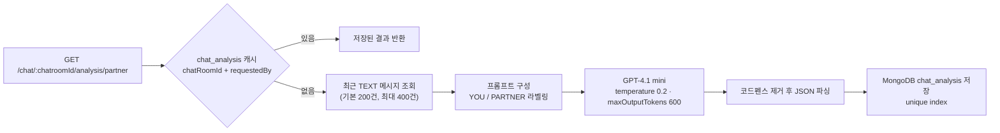

| 응답 필드 | 의미 |
| --- | --- |
| `summary` | 상대 성향 핵심 한 줄 |
| `style` | 말투·길이·반응 속도 요약 |
| `topTips` | 실제로 도움이 되는 행동 팁 3개 |
| `caution` | 오해하기 쉬운 점 1개 |
| `confidence` | 메시지가 부족할수록 낮아지는 신뢰도 |

- 프롬프트에는 **메시지 본문과 `YOU`/`PARTNER` 라벨만** 넣고 사용자 ID는 넣지 않습니다(`buildBriefPrompt`).
- 유니크 인덱스(`room_requester_unique`)로 중복 저장을 막고, 이미 분석한 요청자는 저장된 문서를 그대로 반환합니다.
- 호출 실패 시 예외를 그대로 올리지 않고 "AI 분석 호출에 실패했습니다" 메시지로 감싸 사용자에게 재시도를 안내합니다.

---

## 10. 푸시 알림과 PWA

| 구분 | 내용 | 근거 |
| --- | --- | --- |
| 토큰 등록 | 앱 초기화 3초 후 FCM 토큰 발급 → `POST /push/token` 등록, 로그아웃 시 해제 | `components/app/AppInitializer.tsx`, `PushController` |
| 발송 | FCM Multicast, 토큰 500개 단위 분할 전송, 영구 오류(`INVALID_ARGUMENT`·`NOT_FOUND`) 토큰은 비활성 처리 | `FcmService` |
| 발송 시점 | 채팅/찌르기/통화 이벤트(채팅 컨트롤러), 찌르기·추측·게임 종료 알림 | `ChatWebSocketController`, `NoticeService` |
| 알림함 | 미션(매일 09:00 KST) · 추측 · 찌르기 · 종료 알림을 `notification` 테이블에 저장, 읽음/전체 삭제 | `MissionNoticeScheduler`, `NoticeController` |
| PWA | manifest(`또마니또`, standalone), `autoUpdate` 서비스 워커, API 경로는 `NetworkOnly`, 설치 배너 | `vite.config.ts`, `components/ui/InstallBanner.tsx` |
| 백그라운드 수신 | `firebase-messaging-sw.js`에서 알림 표시·클릭 시 링크 이동 | `frontend/public/firebase-messaging-sw.js` |

> 미션 알림(09:00)은 알림함에 저장되는 인앱 알림이고, FCM 푸시는 채팅 이벤트와 찌르기·추측·종료 알림에서 발송됩니다.

---

## 11. 인증과 인가

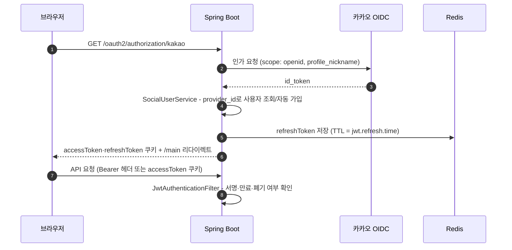

- **토큰 전달**: 액세스/리프레시 토큰을 HttpOnly 쿠키로 내려주고, 필터는 `Authorization: Bearer` 헤더를 먼저 보고 없으면 쿠키를 읽습니다(`JwtAuthenticationFilter`).
- **리프레시**: `POST /auth/refresh`는 Redis에 저장된 리프레시 토큰과 대조한 뒤 액세스 토큰만 재발급합니다(`AuthService`). 만료된 리프레시 토큰은 저장소에서 삭제합니다.
- **로그아웃**: `/auth/logout`이 쿠키를 지우고, 폐기할 토큰은 `at:revoked:{token}` 키로 남은 만료 시간만큼 Redis에 보관합니다(`TokenRevocationService`).
- **탈퇴 계정**: `JwtUserDetails.isEnabled()`가 `ACTIVE` 상태만 허용하고, 필터가 예외를 만나면 쿠키를 지우고 인증 컨텍스트를 비웁니다.
- **화면 접근 제어**(프론트): `RequireAuthGuard`(로그인), `PreventAuthGuard`(로그인 상태에서 로그인 화면 차단), `GameStatusGuard`(`IN_NONE`/`IN_WAITING`/`IN_GAME` 3상태), `RoomGuard`(방 상태별 접근)로 나눠 관리합니다.
- **개발용 로그인**: `POST /auth/dev/login`(`auth.dev.enabled=true`)과 로그인 화면의 "개발자 로그인" 버튼으로 카카오 없이 특정 `userId`로 진입할 수 있습니다.

---

## 12. 트러블슈팅

백엔드와 공통 영역에서 실제로 겪고 해결한 문제를 정리합니다.

### 12.1 WebSocket 1:1 라우팅이 되지 않던 문제

- **증상**: `convertAndSendToUser`로 보낸 메시지가 상대에게 도착하지 않거나, `Principal`이 비어 라우팅 키를 만들 수 없음.
- **원인**: HTTP 요청의 인증 정보는 `ThreadLocal` 기반 `SecurityContext`에 있어 비동기 WebSocket 채널로 전파되지 않았고, STOMP 프레임의 `Principal`이 비어 있었음.
- **해결**: `JwtUserDetails`가 `UserDetails`와 `Principal`을 동시에 구현하도록 통일하고, 2단계로 주입했습니다. 핸드셰이크(`JwtHandshakeInterceptor`)에서 JWT를 검증해 세션 속성에 넣고, STOMP `CONNECT`(`WebSocketAuthChannelInterceptor`)에서 `StompHeaderAccessor.setUser()`로 `Principal`을 세웁니다. `getName()`이 `userId`를 반환해 HTTP 컨트롤러와 `@MessageMapping`이 같은 식별자를 씁니다.
- **결과**: 개인 큐(`/user/queue/chat.{chatRoomId}`)로 해당 사용자에게만 전달되고, 방 단위 토픽과 역할이 분리됨.
- **근거**: `JwtUserDetails`, `JwtHandshakeInterceptor`, `WebSocketAuthChannelInterceptor`, `WebSocketConfig`

### 12.2 활동 집계가 두 번 반영되던 문제

- **원인**: 매일 00:00:01 스케줄러(전날 집계)와 방 종료 시 즉시 집계가 같은 날짜를 중복 처리할 수 있음.
- **해결**: 종료된 방이면서 종료일이 집계 대상일과 같으면 스킵하도록 필터링(`aggregateForDate`). 스케줄러·집계 모두 `Asia/Seoul` 고정.
- **근거**: `ActivityAggregationService`, `ManitoService.finishRoom`

### 12.3 랭킹 지표의 갱신 시점이 다른 문제

- **현상**: 채팅 수·통화 시간은 전날까지 집계된 `manito_activity` 값을 쓰고, 미션 수행 수는 `mission_status`를 실시간으로 세어 순위를 만듦.
- **정리**: 일 단위 집계 배치는 유지하고, 화면에 "채팅 순위는 매일 자정에, 미션 순위는 실시간으로 업데이트됩니다"로 갱신 시점을 안내.
- **근거**: `RankingService`, `pages/Rank/RankingPage.tsx`

### 12.4 프록시·배포 도메인 환경에서 인증 쿠키가 전달되지 않던 문제

- **원인**: 토큰을 HttpOnly 쿠키로 내려주므로, Nginx 뒤 HTTPS 환경과 PWA 도메인에서는 `Secure`·`SameSite`·`Domain`이 맞지 않으면 브라우저가 쿠키를 싣지 않습니다. 도메인·경로가 다른 이전 쿠키가 남아 있으면 삭제 후에도 인증이 꼬이기도 합니다.
- **해결**: `CookieUtils`가 `X-Forwarded-Proto`로 `secure`·`SameSite`(HTTPS면 `None`, 로컬이면 `Lax`)를, `X-Forwarded-Host`로 `Domain`을 결정해 쿠키를 발급하고, 삭제 시 host-only·`/api` 경로 변형까지 함께 지웁니다. 서버는 `server.forward-headers-strategy=native`로 프록시 헤더를 신뢰하고, CORS는 `allowCredentials=true`로 쿠키 전송을 허용합니다.
- **근거**: `CookieUtils`, `SecurityConfig`, `WebMvcConfig`, `application.properties`

### 12.5 운영 환경에서 WebSocket·미디어가 붙지 않던 문제

- **원인**: HTTPS 종료 지점(Nginx)과 백엔드 포트가 다르고, WebRTC는 별도 시그널링·TURN이 필요.
- **해결**: 80 → 443 리다이렉트, `/ws/`는 `Upgrade`/`Connection` 헤더를 유지해 프록시, `/openvidu/`·`/dashboard/`는 4443으로 프록시하며 `proxy_read_timeout`을 3600s로 늘림. TURN(coturn)을 별도 컨테이너로 두고 `localhost`가 아닌 공인 도메인을 ICE 서버로 지정.
- **근거**: `nginx/default.conf`

### 12.6 시간대가 하루씩 어긋나던 문제

- **해결**: 서버는 모든 도메인 코드에서 `ZoneId.of("Asia/Seoul")`을 명시하고, JPA·Jackson 타임존을 `Asia/Seoul`로 고정. 프론트도 `dayjs.tz.setDefault('Asia/Seoul')`로 맞춤. 스케줄러는 `@Scheduled(zone = "Asia/Seoul")` 사용.
- **근거**: `application.properties`, `DailyActivityScheduler`, `HomePage.tsx`

---

## 13. 로컬 실행

### 13.1 사전 준비

| 도구 | 버전 |
| --- | --- |
| JDK | 17 |
| Node.js | 22 (`.nvmrc` 기준) |
| Docker / Docker Compose | Compose v1.29 이상 |
| Gradle | wrapper 사용(`./gradlew`) |

### 13.2 인프라 기동

```bash
# 저장소 루트에서
docker compose up -d mysql redis mongo mongo-express openvidu-server-kms coturn
```

| 서비스 | 접속 |
| --- | --- |
| MySQL | `localhost:3306` |
| Redis | `localhost:6379` |
| MongoDB | `localhost:27017` |
| Mongo Express | http://localhost:8081 |
| OpenVidu | https://localhost:4443 (자체 서명 인증서 경고 발생) |
| coturn | `localhost:3478` |

### 13.3 스키마와 시드 데이터

`spring.jpa.hibernate.ddl-auto=none`이므로 스키마를 직접 넣어야 합니다.

```bash
mysql -h 127.0.0.1 -u <user> -p <database> < exec/DataBase/ttomanito_ddl.sql   # 17개 테이블
mysql -h 127.0.0.1 -u <user> -p <database> < exec/DataBase/mission_data.sql    # 미션 95건
```

### 13.4 백엔드 환경 변수

`backend/src/main/resources/application.properties`가 참조하는 키입니다.

| 키 | 용도 |
| --- | --- |
| `SPRING_PORT` | 서버 포트 (기본 8080) |
| `MYSQL_DATABASE`, `MYSQL_USER`, `MYSQL_PASSWORD` | MySQL 접속 |
| `MONGO_DATABASE` | MongoDB 데이터베이스 이름 |
| `SPRING_REDIS_HOST` | Redis 호스트 |
| `KAKAO_CLIENT_ID` | 카카오 OIDC 클라이언트 ID |
| `JWT_SECRET` | JWT 서명 키 |
| `OPENVIDU_URL`, `OPENVIDU_SECRET` | OpenVidu 서버 주소·시크릿 |
| `OPENAI_API_KEY` | 성향 분석 |
| `GOOGLE_APPLICATION_CREDENTIALS` 또는 `fcm.credentials.location` | FCM 서비스 계정 (`fcm.enabled=true`) |

> `docker-compose.yml`로 백엔드를 올릴 때는 `SPRING_DATASOURCE_URL`·`SPRING_DATA_REDIS_HOST`·`SPRING_DATA_MONGODB_URI`가 우선 적용되고, `secrets/prod` 디렉터리가 `/run/secrets`로 읽기 전용 마운트됩니다.

### 13.5 실행

```bash
# 백엔드
cd backend
./gradlew clean build -x test
./gradlew bootRun                 # http://localhost:8080
# Swagger UI: http://localhost:8080/swagger-ui/index.html (OpenAPI: /v3/api-docs)

# 프론트엔드
cd frontend
npm install
npm run dev                       # http://localhost:5173
```

### 13.6 로컬 실행 시 주의

- **소켓 주소**: `useChatSocket.ts`·`useWaitingRoomSocket.ts`의 SockJS URL이 배포 도메인으로 고정되어 있고 로컬 주소는 주석 처리되어 있습니다. 실시간 기능을 로컬에서 확인하려면 두 파일의 주소를 `http://localhost:8080/ws/...`로 바꿔야 합니다.
- **프론트 프록시**: `vite.config.ts`의 `/api`, `/oauth2`, `/login/oauth2`, `/ws` 프록시가 배포 도메인을 바라봅니다. 로컬 백엔드로 붙이려면 `target`을 `http://localhost:8080`으로 변경합니다.
- **인증서 경고**: 로컬 OpenVidu는 자체 서명 인증서라 브라우저 경고가 뜹니다. 개발 중에는 예외 허용으로 진행합니다.
- **미디어 사용**: WebRTC 마이크는 `localhost` 또는 HTTPS에서만 동작합니다.
- **빌드 산출물**: 백엔드 jar 이름은 `ttomanito-1.0.0.jar`(`backend/Dockerfile` 기준)입니다.

---

## 14. API 요약

REST 엔드포인트 57개, STOMP 메시지 매핑 8개입니다. 인증이 필요한 요청은 액세스 토큰(쿠키 또는 Bearer)을 사용합니다.

| 도메인 | Method | Path | 설명 |
| --- | --- | --- | --- |
| 인증 | GET | `/auth/me` | 현재 로그인 사용자 조회 |
| 인증 | POST | `/auth/refresh` | 액세스 토큰 재발급 |
| 인증 | GET | `/auth/kakao/logout-page`, `/auth/kakao/logout/callback` | 카카오 로그아웃 페이지·콜백 |
| 인증 | POST | `/auth/dev/login` | 개발용 임의 로그인 (userId) |
| 사용자 | GET | `/user/profile` | 내 프로필 |
| 사용자 | POST | `/user/update` | 이름 수정 |
| 사용자 | POST | `/user/delete` | 회원 탈퇴 |
| 사용자 | GET | `/user/{userId}` | 다른 사용자 이름 조회 |
| 방 | GET | `/room/check` | 내 게임 상태(`IN_NONE`/`IN_WAITING`/`IN_GAME`) |
| 방 | POST | `/room` | 방 생성 |
| 방 | GET | `/room/{roomId}` | 방 정보(이름·상태·기간·미션 요일) |
| 방 | GET | `/room/{roomId}/participants` | 참가자 목록 |
| 방 | POST | `/room/{roomId}/message` | 상태 메시지 작성 및 입장 |
| 방 | POST | `/room/{roomId}/start` | 게임 시작(방장, 4명 이상) |
| 방 | DELETE | `/room/{roomId}/participants/{targetUserId}` | 참가자 강퇴 |
| 방 | DELETE | `/room/{roomId}/exit` | 방 나가기 |
| 방 | POST | `/room/exit` | 대기방 닫기(방장) |
| 방 | GET | `/room/creator`, `/room/roomId` | 방장 여부 / 내 활성 방 ID |
| 방-사용자 | GET | `/room-user/{roomId}/me`, `/room-user/me/active` | 내 `roomUserId` 조회 |
| 마니또 | GET | `/manito/manitee` | 내 마니띠 사용자 ID |
| 마니또 | POST | `/manito/guess` | 마니또 추측 제출 |
| 마니또 | GET | `/manito/guess/history` | 추측 이력 |
| 마니또 | POST | `/manito/finish` | 게임 종료(방장) |
| 미션 | GET | `/manito/mission` | 오늘의 미션(요일 검증·중복 방지) |
| 미션 | GET | `/manito/mission/missionlist` | 내 미션 이력 |
| 미션 | PATCH | `/manito/mission/{missionStatusId}/success` | 미션 완료 |
| 채팅 | GET | `/chat/roomlist` | 내 마니또/마니띠 채팅방 |
| 채팅 | GET | `/chat/room/manito`, `/chat/room/manitee` | 역할별 채팅방 조회 |
| 채팅 | POST | `/chat/{chatroomId}/enter` | 채팅방 입장(미읽음 초기화) |
| 채팅 | GET | `/chat/{chatroomId}/is-user/{userId}` | 채팅방 참여 여부 |
| 채팅 | GET | `/chat/{chatroomId}/analysis/partner` | 상대 성향 AI 분석(요청자당 1회) |
| 통화 | POST | `/openvidu/token` | OpenVidu 세션/토큰 발급 |
| 통화 | POST | `/chat/{chatroomId}/call/start` | 통화 시작 |
| 통화 | POST | `/chat/{chatroomId}/call/accept` | 통화 수락 |
| 통화 | POST | `/chat/{chatroomId}/call/reject` | 통화 거절 |
| 통화 | POST | `/chat/{chatroomId}/call/end` | 통화 종료(통화 시간 누적) |
| 랭킹 | GET | `/rank/{genreId}` | 1: 통화 시간, 2: 채팅 수, 3: 미션 수 |
| 리포트 | GET | `/report/history` | 종료된 방 리포트 목록 |
| 리포트 | GET | `/report/reportdetail/{roomId}` | 리포트 상세 |
| 알림 | GET | `/notice` | 읽지 않은 알림 |
| 알림 | PATCH | `/notice/check` | 전체 읽음 |
| 알림 | DELETE | `/notice/delete` | 전체 삭제 |
| 알림 | POST | `/notice/poke`, `/notice/guess`, `/notice/{roomId}/finish`, `/notice/exit` | 알림 생성 |
| 찌르기 | POST | `/poke` | 찌르기 실행 |
| 푸시 | POST | `/push/token` | FCM 토큰 등록/갱신 |
| 푸시 | DELETE | `/push/token`, `/push/tokens` | 토큰 해제 / 전체 해제 |

---

## 15. 디렉터리 구조

```text
ttomanito/
├── backend/
│   ├── build.gradle, settings.gradle, Dockerfile
│   └── src/main/
│       ├── java/com/ssafy/ttomanito/
│       │   ├── config/            Security, WebSocket, Redis, Swagger, FCM, OpenAI, Scheduler
│       │   ├── domain/
│       │   │   ├── auth/          JWT·OAuth 인증, 토큰 재발급
│       │   │   ├── user, oauth/   사용자, 소셜 계정 매핑
│       │   │   ├── room/          방·참가자·미션 요일·대기방 소켓
│       │   │   ├── manito/        마니또 배정·추측·활동 집계
│       │   │   ├── mission/       미션 마스터·일일 미션·완료 상태
│       │   │   ├── chatting/      채팅방·메시지·음성 통화·AI 분석
│       │   │   ├── poke, notice/  찌르기 로그, 알림
│       │   │   ├── rank, report/  순위, 관찰 리포트
│       │   │   └── push/          FCM 토큰·발송
│       │   └── global/            예외 처리, JWT 필터·인터셉터, 스케줄러
│       └── resources/             application.properties, DDL
├── frontend/
│   ├── package.json, vite.config.ts, Dockerfile, nginx.conf
│   ├── public/                    manifest, firebase-messaging-sw.js, 폰트, 아이콘
│   └── src/
│       ├── api/                   axios 클라이언트, 도메인별 요청
│       ├── components/            공통 UI, 채팅, 목록, 모달, 레이아웃
│       ├── hooks/                 useOpenVidu1to1, useChatAnalysis, useRoomInfo
│       ├── pages/                 Main, Room, Home, Chat, Guess, Rank, Report, User
│       ├── routes/                라우팅과 접근 가드
│       ├── stores/                zustand(auth, modal)
│       ├── theme/, styles/, assets/
│       └── utils/                 useChatSocket, useWaitingRoomSocket, jwtparser
├── nginx/default.conf             리버스 프록시·SSL 설정
├── exec/                          ERD, 화면 캡처, 화면 시나리오, DDL/시드, 배포 매뉴얼
└── docker-compose.yml             전체 스택 정의
```

---

## 16. 추후 개선 방향

### 기능 완결성

1. **음성 통화 흐름 연결** — 채팅방 진입점, 수락 후 통화방 이동, 서버 주도의 세션 발급으로 [8.3](#83-추후-개선-방향) 항목을 순서대로 마무리.
2. **채팅방 참여자 API 정합성** — 프론트는 `/chat/{chatRoomId}/participants`를 호출하지만 백엔드에 해당 매핑이 없어 상대 정보가 기본값으로 표시됩니다. 매핑 추가 또는 기존 `/room/{roomId}/participants`·`/chat/roomlist` 응답으로 대체 필요.
3. **AI 분석 정책 세분화** — 현재는 요청자당 1회로 고정입니다. 대화가 충분히 쌓인 뒤 재분석을 허용하거나, 캐시 만료 기간을 두는 정책이 필요합니다.
4. **변조 프리셋 선택 UI** — 세미톤·wet 파라미터를 사용자 선택값으로 노출하고 통화 상대에게도 현재 프리셋을 알려주기.

### 품질·운영

5. **테스트 코드** — 백엔드는 `src/test`가 없어 빌드를 `-x test`로 수행합니다. 최소한 배정 로직(`startGame`)·미션 발급·집계 중복 방지·인증 필터에 대한 단위/통합 테스트가 필요합니다. 프론트는 Storybook 스토리 20개와 Vitest 브라우저 설정이 있으므로 컴포넌트 단위 검증으로 확장 가능합니다.
6. **환경 설정 외부화** — 소켓 URL, ICE(TURN) 설정, 배포 도메인을 `.env` 기반으로 옮겨 로컬/운영 전환을 코드 수정 없이 처리.
7. **관측성** — 현재 액추에이터·메트릭이 없습니다. 헬스체크, 요청 로깅(현재 예외 로그에 `errorId` 발급), WebSocket 세션 수 모니터링 추가.
8. **스케줄러 신뢰성** — 집계·종료·알림 스케줄러가 단일 스레드(`poolSize=1`)로 동작합니다. 서버 다중화 시 중복 실행 방지(분산 락)와 실패 재시도 정책 필요.
9. **알림 채널 확장** — 미션 알림은 인앱 알림만 저장되므로 FCM 발송까지 연결하면 재방문 유도에 도움이 됩니다.
10. **문서 정리** — `exec/README.md`의 프레임워크 버전(Spring Boot 3.4.5 등)이 실제 `build.gradle`(3.5.3)과 다릅니다. 배포 매뉴얼의 버전·명령을 최신 코드 기준으로 갱신 필요.

---

## 참고 문서

| 문서 | 내용 |
| --- | --- |
| `exec/README.md` | Docker Compose 기반 빌드·배포 매뉴얼 |
| `exec/Demo/화면시나리오.pdf` | 화면 흐름 시나리오 |
| `exec/Demo/ttomanito-capture/` | 주요 화면 캡처 15장 |
| `exec/Erd/또마니또erd.png` | 전체 ERD |
| `exec/DataBase/ttomanito_ddl.sql`, `mission_data.sql` | 스키마 DDL, 미션 시드 95건 |
| `/swagger-ui/index.html` | 실행 중인 서버의 API 문서(springdoc) |
